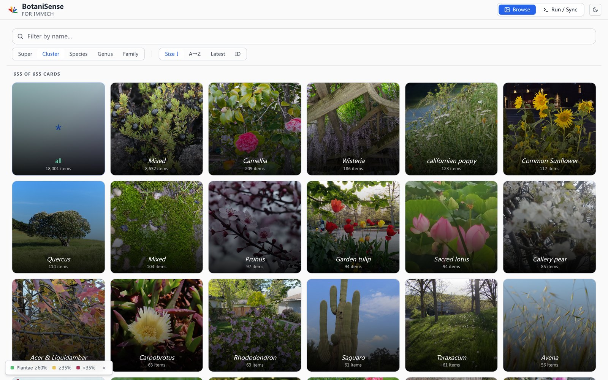
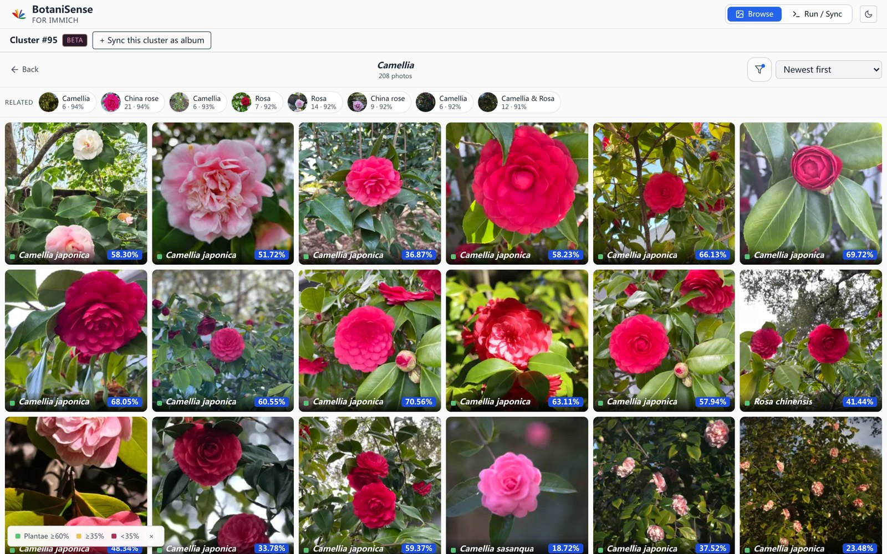

# BotaniSense for Immich

> **Browse your Immich library by plant species.**
> BioCLIP-2 zero-shot classification + optional KNN reclassification,
> with smart-album sync back to Immich.

[](LICENSE)
[](https://immich.app)
[](https://www.python.org)

BotaniSense for Immich is a self-hosted companion to
[Immich](https://immich.app) that classifies plant (and other
organism) photos using [BioCLIP-2](https://arxiv.org/abs/2311.18803),
then helps you organise the results — by cluster, species, genus, or
family — and optionally push curated albums back into Immich.

The ML engine inside is BioCLIP-2 (a CLIP model fine-tuned on the
TreeOfLife-200M label set). The app is "BotaniSense for Immich";
keep the two names straight when reading the code, comments, or this
README — see [DEVELOPMENT.md](DEVELOPMENT.md) for the dual-naming
convention.

---

## Features

- **Immich smart-search ingestion.** Run a seed query (e.g. "red
  flowers", "moss on rocks"); the app pulls the top-N matching assets
  from Immich's `/api/search/smart`.
- **BioCLIP-2 zero-shot species prediction.** Top-K (default 5) species
  per asset, with full taxonomy. Lazy-loaded in a child process — your
  backend process never holds the ~4.3 GB model weights + label table.
- **YOLO-World person detection.** Per-asset flag (`has_person`),
  drives both a filter and the "with/without people" album-sync toggle.
- **HDBSCAN clustering** of BioCLIP embeddings for browse-level
  organisation; auto-refit on library growth.
- **Map view — places, not trips.** Geotagged photos are grouped by
  distance alone (150 m venues or 1 km areas) and plotted on an
  OpenStreetMap/Leaflet map. The same park visited across months stays
  one marker; clicking it opens exactly that place's photos in the
  normal grid. Photos without GPS are reported separately.
- **Optional KNN reclassification** against a FAISS index over
  TreeOfLife-200M (~867k species labels) — a debugging /
  understanding tool, not recommended over zero-shot (it is less
  accurate in the current setup and memory-hungry); see
  [KNN reclassification](#knn-reclassification-debug-tool-not-recommended).
- **Immich album sync.** Sync photos matching a Plantae or Fungi
  threshold as smart albums; per-cluster album sync (beta); bulk
  remove.
- **FastAPI backend + React/Vite SPA.** Live SSE pipeline progress,
  per-job status panels, dark theme, mobile-responsive.

### Map view

The **Map** tab (`#map`) needs GPS coordinates on the assets. The
pipeline stores them at ingest; for libraries indexed before that
feature existed, run **Backfill EXIF** on the Run page once. The
grouping is server-side (`map_clusters.py`, `/api/map/clusters`) and
deliberately ignores time: photos join the nearest place centroid
within the radius, so a balcony or park revisited over years is one
marker. Clicking a marker opens a photo sheet **over** the map
(thumbnails, date range, visits); **Open in grid** is the escape hatch to
the full filtered grid. Markers are uniform green and sized by photo
count — inference is a per-photo property, not a place property, so it
never changes a cluster's colour. In the place's photo strip, a small
amber dot marks individual photos whose position was inferred. OpenStreetMap
tiles require outbound HTTPS from the *browser* (no API key, no account).

The same component powers two deliberately different surfaces:

- **Map tab (`#map`) — independent.** It ignores whatever cluster,
  species or person filter the Browse tab happens to be on. The URL keeps
  that state for Browse, but the map is global.
- **Grid map button — scoped modal.** The map pin in a filtered photo
  grid opens the map as a modal for exactly those photos ("where are
  they?"). Closing it returns to the grid; opening a place from it keeps
  the grid's filter and narrows to that place.

Radius can be 150 m (venue), 1 km (area) or 10 km (region). Switching it
**keeps the current viewport** — only the markers change; the **Fit**
button re-frames explicitly, and the viewport + radius survive tab
switches for the session.

**Inferred locations (local only).** Photos from cameras without a GPS
fix can borrow coordinates from GPS-tagged photos taken within ±15
minutes and 1 km (interpolated, with the two anchor photos recorded).
This is the **Infer from nearby GPS** action in the map panel; the same
computation is available as `scripts/guess_locations.py --apply`. It
writes only `location_guesses` in the local SQLite DB — `assets.*` and
Immich are never modified, a real EXIF fix always wins, and **Clear**
(or `--clear`) removes every guess. Inferred markers are amber on the
map; the place sheet marks each inferred photo with a small amber dot.

---

## Architecture

```
Immich (REST)               React/Vite SPA
     │  /api/search/smart         │
     │  /api/albums, etc.         │  fetchJson → /api/*
     ▼                            ▼
     ┌─────── FastAPI backend (uvicorn :8765) ──────────┐
     │                                                   │
     │   storage.py      pipeline.py        knn.py       │
     │   (SQLite)        (BioCLIP-2 child    (FAISS,     │
     │                    process)           optional)   │
     └───────────────────────────────────────────────────┘
                  │             │             │
                  ▼             ▼             ▼
              state.db    BioCLIP-2      FAISS index
              (assets,    weights +      (optional;
              embeddings, labels         download or
              predictions) (~4.3 GB      build)
                           on disk)
```

A 17 000-photo library is the realistic scale at which this app
shines. Below ~1 000 photos the run-once latency dominates; above
~50 000 the HDBSCAN refit starts to need attention.

---

## Prerequisites

- **Docker** (with Compose v2) — the only install path
- An **Immich instance** with an admin API key — see
  [Immich → Administration → Settings → API Keys][immich-keys]
- **~6 GB free RAM** during a pipeline run (measured ~5.9 GB: BioCLIP-2
  weights + species label table live in the child process). The web
  server itself stays at ~250 MB.
- **~10 GB free disk**: ~2.5 GB for the Docker image, ~4.3 GB for the
  BioCLIP-2 artifacts (model weights + species label table, downloaded
  on first run into `data/huggingface/`), and the SQLite state DB
  (hundreds of MB at ~17 000 photos). Add ~20 GB if you opt into the
  KNN index.
- The BioCLIP-2 model itself, from
  [`imageomics/bioclip-2`][bioclip-hf] — downloaded automatically on
  first use

[immich-keys]: https://immich.app/docs/administration/users-and-access
[bioclip-hf]: https://huggingface.co/imageomics/bioclip-2

---

## Quickstart

```bash
git clone https://github.com/cxcxcxcx/botanisense-for-immich
cd botanisense-for-immich

# 1. Build + run
docker compose up --build -d

# 2. Open http://<this-host>:8765 — from any LAN device; the server
#    binds 0.0.0.0. (http://localhost:8765 works only on the host
#    itself.)
#    → the Welcome screen asks for your Immich URL and API key.
#      Click "Save & test connection" — it verifies immediately.
```

No `.env`, no config files. The Immich URL + API key you enter are
stored in the app's database (`./data/`) and take effect immediately;
you can change them any time via **Fix connection** in the health
banner or the **Edit** link on the Run page → Sync to IMMICH section.

Don't want to build locally? Uncomment the `image:` line in
`compose.yml` to pull the prebuilt image from GHCR instead
(published by CI on every release). Prefer not to type the key into
the web UI? Set `IMMICH_BASE_URL` / `IMMICH_API_KEY` in `compose.yml`
or a `.env` file instead — environment variables pin the connection.

The image contains the backend and the built web UI (~2.5 GB; CPU-only
torch). BioCLIP-2 downloads into `./data/` on the first pipeline run.
To enable the optional KNN reclassification, see
[KNN reclassification](#knn-reclassification-debug-tool-not-recommended).

Contributing or developing from source (Python + Node)? See
[DEVELOPMENT.md](DEVELOPMENT.md).

---

## Screenshots

Browse your library as auto-named **cluster cards** — each cover is
the most representative *person-free* photo in the group:



Click a card for its photo grid — every image tagged with the top
species prediction and confidence, with a strip of related clusters
on top:



The same browse levels exist for **species, genus, and family**, plus
a global search and smart-album sync back to Immich.

---

## Configuration

Two surfaces, both optional:

1. **The web UI** — the Immich URL + API key, stored in the app's
   SQLite DB. This is the default path and needs no files.
2. **Environment variables** — for automation, or to pin values so
   UI edits can't change them (e.g. Immich reached over a Docker
   network hostname). Compose and `.env` land here. Precedence for
   the Immich connection is **environment > web UI**.

| Key | Default | Notes |
|---|---|---|
| `IMMICH_BASE_URL` | _(none — set in the web UI)_ | Where the server reaches Immich |
| `IMMICH_API_KEY` | _(none — set in the web UI)_ | Immich admin API key |
| `IMMICH_PUBLIC_URL` | = `IMMICH_BASE_URL` | Browser-side Immich URL for "Open in Immich" |
| `KNN_INVENTORY_DIR` | _(empty; KNN off)_ | Directory holding a KNN index |
| `CORS_ORIGINS` | _(any origin)_ | Comma-separated; empty = same-origin only |
| `QUERY` | `"intentional plant photos"` | Seed query |
| `N_SAMPLES` | `10000` | Max assets per run |
| `TOP_K` | `5` | Species predictions per asset |
| `BATCH_SIZE` | `16` | Inference batch size |
| `DB_PATH` | `data/state.db` | SQLite location |
| `HOST`, `PORT` | `0.0.0.0`, `8765` | Server bind |
| `RUN_ON_STARTUP` | `0` (off) | Run the pipeline once at boot |
| `PIPELINE_CRON` | _(off)_ | Daily pipeline run at HH:MM |
| `TZ` | host zone / UTC | IANA zone for log timestamps |
| `PLANTAE_GREEN`, `PLANTAE_YELLOW` | `0.60`, `0.35` | Confidence tier thresholds |
| `FUNGI_MIN_SCORE_DEFAULT` | `0.60` | Fungi sync threshold |

`IMMICH_PUBLIC_URL` matters in Docker setups where the server reaches
Immich over a hostname the browser can't resolve (e.g. both in one
compose network): the server keeps using `IMMICH_BASE_URL`, while
"Open in Immich" links use the public URL. `PIPELINE_CRON` (HH:MM)
runs the pipeline daily at that time. `TZ` sets the zone used for log timestamps: `compose.yml` mounts the
host's `/etc/localtime`, which covers Linux automatically — set `TZ`
in `.env` on Docker Desktop (macOS/Windows) or to pin a zone.
`CORS_ORIGINS` takes a
comma-separated origin list; set it empty for same-origin only.

---

## How it works

BioCLIP-2 ([Stevens et al., CVPR 2024][paper]) is a CLIP-style model
fine-tuned on the TreeOfLife-200M dataset. For each Immich asset, we
run it in zero-shot mode — no per-library training — and rank the
candidate species by cosine similarity to the asset's image embedding.
We surface the top-K (default 5) along with the full taxonomy
hierarchy (kingdom → family → genus → species) and a Plantae-tier
confidence score that drives the per-image green/yellow/red overlay.

### KNN reclassification (debug tool, not recommended)

KNN mode matches each asset against a FAISS index of ~234M BioCLIP-2
reference embeddings and lets the species labels of the nearest
neighbours vote on the answer. In the current setup it is **less
accurate than plain zero-shot**, and keeping the index resident costs
several GB of RAM — so it is not recommended. Zero-shot predictions
are what the pipeline uses.

The KNN paths exist for debugging and understanding only: inspecting
which reference photos a given image's embedding lands next to, and
where that disagrees with zero-shot. If you want that, two ways to
get an index:

1. **Download the official imageomics index.**

   ```bash
   # Run inside the container (huggingface_hub is already installed
   # there) so the index lands in the persistent ./data volume. ~20 GB.
   docker compose exec botanisense python scripts/download_knn_index.py \
       --out /app/data/knn-index
   ```

   then add `KNN_INVENTORY_DIR: /app/data/knn-index` to the
   `environment:` block in `compose.yml` and `docker compose up -d`
   again. (Alternatively download to any host directory and bind-mount
   it read-only at `/app/knn-index` — see the commented block in
   `compose.yml`.)

2. **Build your own** from a TreeOfLife-200M parquet export with
   `python -m knn` — hours of CPU. The expected layout contract is
   `tol200m_bioclip2.faiss` + `labels.parquet` + `INDEX_VERSION.txt`
   (see `knn_io.py`).

Without an index the feature is simply absent: the UI shows zero-shot
predictions only, and the KNN code paths never load — that is the
recommended configuration. The Data tools card on the Run page shows
a short note saying as much.

[paper]: https://arxiv.org/abs/2311.18803

The frontend is a single-page React/Vite app. State is held in a
small Context + useReducer; server-driven data (results, clusters,
status, logs) is fetched per-component, with one SSE connection
(`/api/events`) for live progress.

---

## Known limits

- **Single-user, no auth.** Suitable for self-hosted LAN use. Don't
  expose the port to the public internet without adding auth in front
  (reverse proxy with basic-auth is a workable minimum).
- **Cluster sync is beta.** Per-cluster `Delete` and bulk `Remove
  synced clusters` always delete the Immich album alongside the local
  mapping (no orphans). Cluster titles may go stale after a cluster
  rename — re-sync to refresh.
- **KNN reclassification is opt-in.** Without an index (downloaded
  official, ~20 GB, or self-built — see
  [KNN reclassification](#knn-reclassification-debug-tool-not-recommended)), only
  zero-shot predictions are available.
- **~6 GB resident during a pipeline run.** The BioCLIP-2 child
  process holds the weights + label table for the duration (measured
  ~5.9 GB); uvicorn itself stays at ~250 MB.
- **Tested against Immich ≥ 1.111.** Earlier versions may lack
  `/api/search/smart` and the album endpoints this app depends on.
- **No telemetry.** The app phones home to nobody — no update checks,
  no analytics, no crash reporting.

---

## Roadmap

Where BotaniSense is headed (direction, not a commitment or timeline):

- **BotaniSense app and cloud sync.** An optional companion app that
  can sync your photos to the cloud and unlock more powerful
  cloud-side features — see [botanisense.app](https://botanisense.app).
- **A smaller, faster model.** Plant identification without the
  multi-gigabyte disk and memory footprint and long initial waits —
  quicker to set up and light enough to run on phones and small devices.

---

## Contributing

See [CONTRIBUTING.md](CONTRIBUTING.md) for setup, test, and commit
guidelines. Be sure to read the "What not to commit" list — there are
some large runtime artifacts (`data/`, `weights/`, `data.state.db`)
that are easy to accidentally `git add`.

---

## Security

See [SECURITY.md](SECURITY.md). Please do **not** file public issues
for suspected security bugs — email the maintainer directly.

---

## License

[MIT](LICENSE) © 2026 Xing Chen.

The BioCLIP-2 model weights are subject to their own license; see the
[imageomics/bioclip-2 model card][bioclip-hf].

---

## Credits

- [BioCLIP-2](https://arxiv.org/abs/2311.18803) (Stevens et al., CVPR
  2024) — the zero-shot species classifier that powers this app.
- [TreeOfLife-200M](https://huggingface.co/datasets/imageomics/TreeOfLife-200M)
  — the label set used by BioCLIP-2.
- [Immich](https://immich.app) — the photo library this app reads
  from and writes back to.
- Author: [Xing Chen](https://github.com/cxcxcxcx).